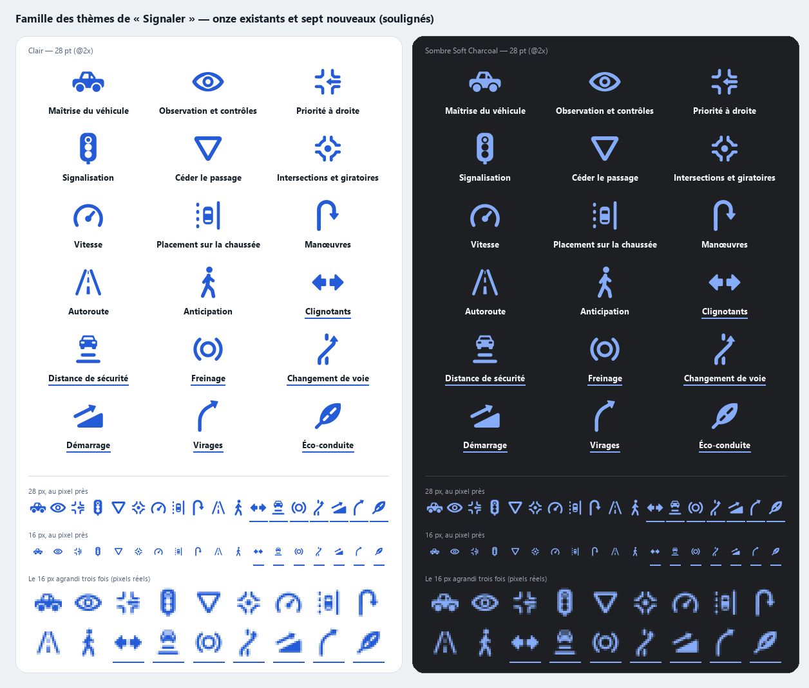
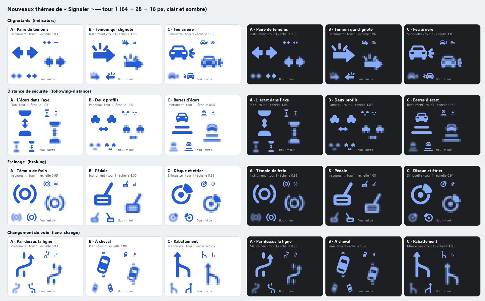
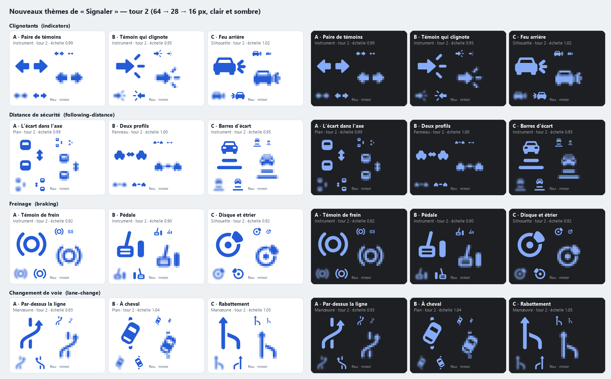
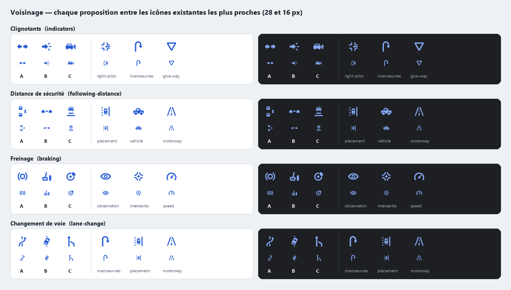
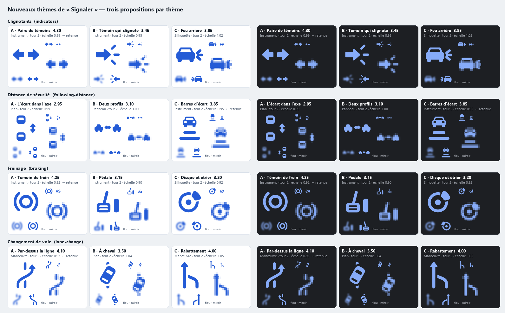
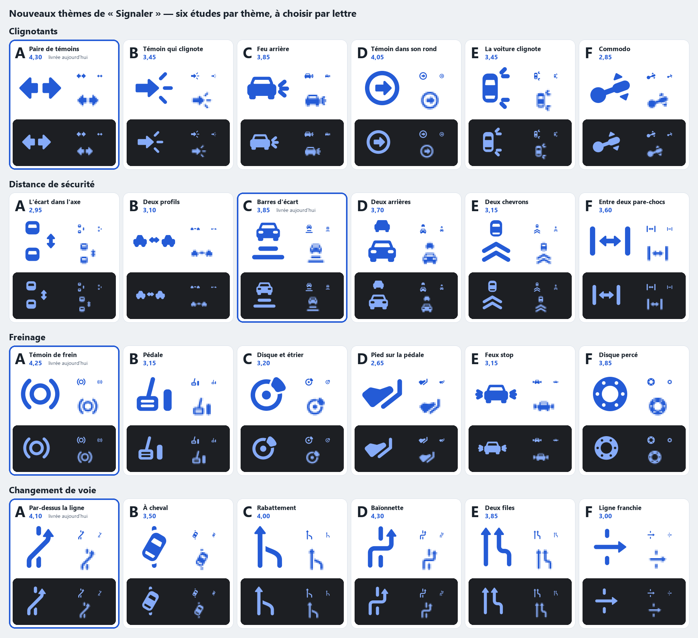
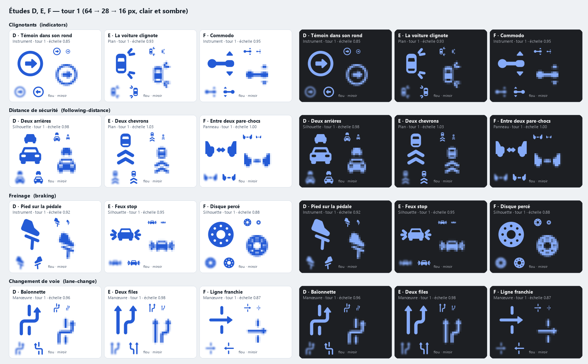
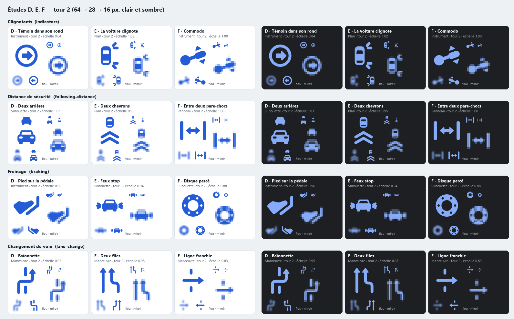
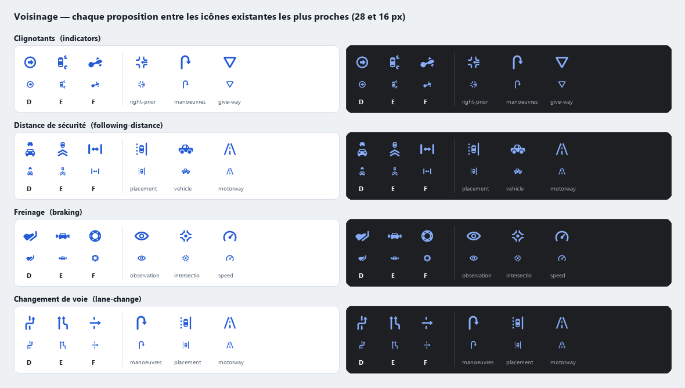
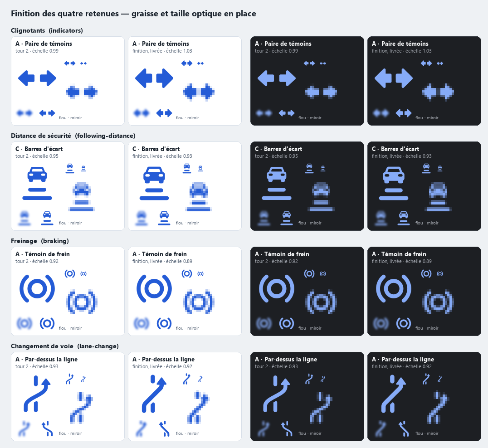

# Icônes des quatre nouveaux thèmes de « Signaler » — 12 octobre 2026

« Signaler » passe de onze à quinze thèmes : **Clignotants**, **Distance de sécurité**, **Freinage** et **Changement de voie**. Ce document décrit leurs pictogrammes : trois propositions par thème, la sélection, les défauts corrigés et l'intégration. Il prolonge [la refonte du 12 octobre](icones-signaler-20261012.md), dont il reprend l'atelier, la grammaire et la grille de notes. Les onze icônes existantes ne sont pas modifiées.

Après avoir vu les quatre retenues, le porteur a demandé trois études de plus par thème. Elles sont décrites dans [Six études par thème](#six-études-par-thème), avec une planche pour choisir par lettre. **L'icône livrée ne change pas tant qu'il n'a pas choisi.**

## Retenues

| Thème | Clé | Retenue | Note | Suivante |
|---|---|---|---|---|
| Clignotants | `indicators` | A · Paire de témoins | 4,30 | C 3,85 |
| Distance de sécurité | `following-distance` | C · Barres d'écart | 3,85 | B 3,10 |
| Freinage | `braking` | A · Témoin de frein | 4,25 | C 3,20 |
| Changement de voie | `lane-change` | A · Par-dessus la ligne | 4,10 | C 4,00 |



La planche de famille relit les quinze SVG du catalogue Xcode, tels que livrés : grille à 28 pt (@2x), puis 28 px et 16 px au pixel près, en clair et en sombre Soft Charcoal. Les quatre nouveaux sont soulignés.

## Besoin de chaque thème

- **Clignotants** : signaler ses intentions. Le moniteur note un clignotant oublié, mis trop tard ou resté allumé. Le sujet est le signal, pas la direction prise.
- **Distance de sécurité** : l'écart avec le véhicule qui précède. Le sujet est l'intervalle, et il faut deux véhicules pour le dire.
- **Freinage** : freinage tardif, brusque ou mal dosé. Le sujet est une commande du véhicule, sans objet visible de l'extérieur.
- **Changement de voie** : changer de voie, se présélectionner, se rabattre après un dépassement. Le sujet est un déplacement latéral par-dessus une ligne.

Chaque icône devait se distinguer d'un coup d'œil des onze existantes, surtout de « Placement sur la chaussée » (voiture entre deux lignes), « Autoroute » (deux bords qui fuient), « Manœuvres » (demi-tour), « Priorité à droite » (bordures et flèche), « Vitesse » (compteur) et « Maîtrise du véhicule » (profil).

## Démarche

1. **Clichés nommés d'abord.** Pour chaque thème, les signes attendus sont listés avant de dessiner (voir chaque thème). Un cliché n'est gardé que s'il est le signe que le conducteur a réellement sous les yeux.
2. **Quatre à six idées en une phrase, trois construites.** Les trois construites sont les plus différentes, pas trois variantes d'un même dessin.
3. **Construction calculée** dans `atelier_signalements.py`, avec les primitives de l'atelier du 12 octobre : canevas 64, formes pleines d'une couleur, épaisseur 6, bouts ronds, contre-formes d'au moins 4, vrais trous `evenodd`.
4. **Rendus regardés à chaque tour** à 64, 28 et 16 px, le 16 px agrandi au pixel près, en clair et en sombre, avec test de flou et de miroir (`rendu.py`). Un défaut nommé par proposition et par tour, deux tours.
5. **Voisinage** : chaque proposition posée à 28 et 16 px entre les icônes existantes les plus proches.
6. **Notes, sélection automatique**, puis **finition des quatre retenues** dans la planche de famille : graisse, taille optique et propreté de la géométrie seulement.





## Propositions et choix

Notes sur cinq : reconnaissance (30 %), qualité graphique (20 %), identité Drivy (15 %), petite taille (20 %), intégration (15 %). La plus forte note de ce premier tour (A, B, C) est retenue ; `export_signalements.py` recalcule les totaux et refuse une retenue ou un argument qui ne correspond pas aux notes. Les notes sont un jugement posé après avoir regardé les rendus, pas une mesure.



### Clignotants

Clichés : la double flèche d'échange, l'ampoule qui rayonne, le levier. Idées écartées avant construction : le commodo (illisible), les chevrons séquentiels (lus « suivant »), la flèche en tirets (le pointillé veut dire « inconnu » dans la marque).

| | Idée | Rec. | Qual. | Ident. | Petite | Intég. | Total |
|---|---|---|---|---|---|---|---|
| **A · Paire de témoins** | Les deux flèches du témoin de clignotant, dos à dos, en aplat. | 5 | 4 | 3 | 4 | 5 | **4,30** |
| B · Témoin qui clignote | Une seule flèche de témoin et ses trois éclats. | 4 | 3 | 3 | 3 | 4 | 3,45 |
| C · Feu arrière | L'arrière d'une voiture dont un feu clignote. | 5 | 4 | 3 | 4 | 2 | 3,85 |

- **A retenue.** C'est le témoin que tout conducteur voit au tableau de bord, et aucune autre icône de la grille n'a cette silhouette. La flèche est ici le signe lui-même, pas le cliché « flèche » : c'est la raison pour laquelle elle est gardée.
- **C** est aussi immédiat, mais c'est une seconde voiture à côté de « Maîtrise du véhicule », et une troisième avec celle de la distance de sécurité : sa note d'intégration le dit.
- **B** : ses éclats se lisent « impact ».
- Défauts corrigés. A : à 16 px, deux losanges ; fûts allongés. B : éclats posés sur le fût, lus « clic » ; déplacés à la pointe. C : lunette et deux feux évidés faisaient un visage ; feux pleins.

### Distance de sécurité

Clichés : deux voitures et une double flèche, le chronomètre des deux secondes. Idées écartées avant construction : les chevrons peints au sol (lus « avancer »), deux barres pour deux pare-chocs (une icône d'espacement, plus rien d'une route). La première refonte avait déjà essayé deux voitures et leur écart pour « Vitesse » (2,85).

| | Idée | Rec. | Qual. | Ident. | Petite | Intég. | Total |
|---|---|---|---|---|---|---|---|
| A · L'écart dans l'axe | Le véhicule qui précède, le nôtre, et la cote de l'écart. | 3 | 3 | 4 | 2 | 3 | 2,95 |
| B · Deux profils | Deux voitures de profil qui se suivent, l'écart coté. | 4 | 3 | 3 | 2 | 3 | 3,10 |
| **C · Barres d'écart** | L'arrière du véhicule qui précède et les barres d'écart du régulateur. | 4 | 4 | 3 | 4 | 4 | **3,85** |

- **C retenue.** C'est la seule des trois qui garde une silhouette à 16 px, et c'est le dessin du réglage de distance des régulateurs adaptatifs. La vue est celle du conducteur : ce qu'il a devant lui.
- **B** dit mieux « deux voitures » en grand, mais sa bande de 16 de haut s'efface en petit.
- **A** s'éparpille en trois pièces et se rapproche de « Placement sur la chaussée ».
- Défauts corrigés. A : voitures coupées au bord du canevas, un sablier ; voitures entières et cote sur le côté. B : deux voitures et la cote dessous faisaient deux yeux et une bouche ; la cote monte entre elles. C : voiture posée sur un socle ; barres détachées, la première plus courte que la voiture.
- C'est la retenue la plus faible des quatre : voir les doutes.

### Freinage

Clichés : l'octogone STOP (c'est de la signalisation), les traces de pneus, la voiture qui pique du nez (une troisième voiture). Idées écartées avant construction : les feux stop (jumeau du feu arrière des clignotants), la flèche qui bute sur une barre (lue « tabulation »), la trace qui raccourcit (déjà refusée pour « Vitesse », 2,80).

| | Idée | Rec. | Qual. | Ident. | Petite | Intég. | Total |
|---|---|---|---|---|---|---|---|
| **A · Témoin de frein** | Le témoin de frein : un tambour entre ses deux mâchoires. | 4 | 5 | 4 | 5 | 3 | **4,25** |
| B · Pédale | La pédale de frein, large et striée, au bout de son bras. | 3 | 3 | 3 | 3 | 4 | 3,15 |
| C · Disque et étrier | Un disque de frein pincé par son étrier. | 3 | 4 | 3 | 3 | 3 | 3,20 |

- **A retenue.** C'est le témoin de frein du tableau de bord, sans son point d'exclamation, qui appartient déjà à « Attention ». Il reste net jusqu'à 16 px.
- Sa note d'intégration est de 3 : un anneau entouré d'arcs est parent de l'œil d'« Observation » et du giratoire. Les mâchoires sont à gauche et à droite et la forme est ronde, là où l'œil est une amande et le giratoire quatre bordures ; côte à côte, les trois restent distincts sur planche.
- **B** et **C** demandent d'être devinés : raclette ou rouleau pour la pédale, cible ou camembert pour le disque.
- Défauts corrigés. A : tambour maigre entre deux ondes, lu « vibreur » ; tambour agrandi. B : une raclette ; ajout de l'accélérateur pour donner le contexte (seul ajout de détail, contre un défaut nommé ; il n'a pas suffi). C : l'étrier en part de camembert ; il ne vise plus le centre.

### Changement de voie

Clichés : la flèche en S des panneaux de chantier, le « Y » de fusion. Idées écartées avant construction : les deux flèches de présélection (déjà écartées pour « Intersections »), la flèche en S sans ligne (lue « déviation »).

| | Idée | Rec. | Qual. | Ident. | Petite | Intég. | Total |
|---|---|---|---|---|---|---|---|
| **A · Par-dessus la ligne** | La flèche quitte une voie pour l'autre en passant entre deux tirets. | 5 | 4 | 4 | 3 | 4 | **4,10** |
| B · À cheval | La voiture vue du dessus, en biais sur la ligne pointillée. | 4 | 4 | 4 | 3 | 2 | 3,50 |
| C · Rabattement | Une voie rejoint l'autre : se rabattre. | 4 | 4 | 4 | 4 | 4 | 4,00 |

- **A retenue**, de peu. Elle montre le changement de voie lui-même ; C n'en dit qu'un cas, le rabattement, et garde un air de « h » en petit. C tient mieux à 16 px, A dit mieux le thème.
- **B** est la sœur de « Placement sur la chaussée » : une voiture vue du dessus et une ligne pointillée.
- Défauts corrigés. A : S mou et tirets en miettes ; diagonale franche, tirets allongés. B : colonne étroite ; voiture plus en biais. C : la lettre « h » ; la voie qui se rabat s'arrête à une contre-forme de la voie rejointe, comme la trace mordue par le repère.
- Arbitrage laissé au porteur : la flèche va vers la droite (se rabattre, se présélectionner à droite). Un miroir dirait « déboîter » ; les deux se construisent du même script.

## Six études par thème

Trois études de plus par thème (D, E, F), demandées par le porteur pour choisir lui-même sur planche. Ce sont des idées nouvelles, pas des variantes de A, B, C, et les plus simples possibles. Même méthode : une idée en une phrase, construction dans l'atelier, deux tours avec un défaut nommé et corrigé par dessin, rendus regardés à 64, 28 et 16 px en clair et en sombre, flou, miroir, voisinage. Elles sont notées avec la même grille. Elles ne remplacent rien d'elles-mêmes : le catalogue Xcode et les SVG web portent toujours A, C, A, A.



Une planche par thème, plus grande : [Clignotants](assets/icones-signalements-20261012/choix-indicators.png), [Distance de sécurité](assets/icones-signalements-20261012/choix-following-distance.png), [Freinage](assets/icones-signalements-20261012/choix-braking.png), [Changement de voie](assets/icones-signalements-20261012/choix-lane-change.png). La carte cerclée est l'icône livrée aujourd'hui.





### Clignotants

| | Idée | Rec. | Qual. | Ident. | Petite | Intég. | Total |
|---|---|---|---|---|---|---|---|
| D · Témoin dans son rond | Une seule flèche de témoin dans son voyant rond. | 4 | 4 | 3 | 5 | 4 | 4,05 |
| E · La voiture clignote | La voiture vue du dessus, ses deux clignotants de droite allumés. | 4 | 3 | 4 | 3 | 3 | 3,45 |
| F · Commodo | Le levier de clignotant : on le lève ou on l'abaisse. | 2 | 3 | 3 | 3 | 4 | 2,85 |

- Défauts corrigés. D : voyant maigre une fois réduit ; anneau épaissi, flèche grossie. E : quatre grands éclats lus « pattes » ; éclats courts. F : lu « curseur » ; levier en biais, colonne plus grosse.
- Défauts restants. D se lit « bouton suivant » hors d'une voiture. E est une voiture vue du dessus, comme « Placement », et ses éclats s'empâtent à 16 px. F ne se reconnaît pas : « louche » ou « comète ».
- **Avis : A reste devant (4,30).** D est la plus nette à 16 px, mais c'est A que le conducteur a sous les yeux.

### Distance de sécurité

| | Idée | Rec. | Qual. | Ident. | Petite | Intég. | Total |
|---|---|---|---|---|---|---|---|
| D · Deux arrières | Deux voitures vues de l'arrière, la plus lointaine plus petite. | 4 | 4 | 3 | 4 | 3 | 3,70 |
| E · Deux chevrons | Le véhicule qui précède et deux chevrons au sol jusqu'à lui. | 3 | 3 | 4 | 3 | 3 | 3,15 |
| F · Entre deux pare-chocs | Une cote entre l'avant d'une voiture et l'arrière de l'autre. | 3 | 4 | 2 | 5 | 4 | 3,60 |

- Défauts corrigés. D : la petite voiture coiffait la grande, un totem ; plus d'écart entre les deux. E : voiture et chevrons lus « bonhomme » ou « grade » ; chevrons plus larges et détachés. F : deux moitiés de voiture lues « pinces » ; les pare-chocs sont réduits à deux barres.
- Défauts restants. D ajoute deux voitures à la grille et ne dit l'écart que par la perspective. E reste un empilement, et des chevrons disent aussi « avancer ». F dit « écart » sans dire « véhicule » : c'est une icône de largeur.
- **Avis : aucune ne s'impose.** C garde la plus forte note (3,85). D est la plus parlante sans libellé ; F est la plus lisible à 16 px et la plus générique. C'est le thème où le goût du porteur compte le plus.

### Freinage

| | Idée | Rec. | Qual. | Ident. | Petite | Intég. | Total |
|---|---|---|---|---|---|---|---|
| D · Pied sur la pédale | Un pied appuie sur la pédale de frein. | 3 | 3 | 3 | 2 | 2 | 2,65 |
| E · Feux stop | L'arrière d'une voiture dont les deux feux stop s'allument. | 4 | 3 | 3 | 3 | 2 | 3,15 |
| F · Disque percé | Un disque de frein seul, plein, avec ses perçages. | 4 | 4 | 3 | 4 | 4 | 3,85 |

- Défauts corrigés. D : lu « hachoir » ; talon au sol, pointe relevée, bras de pédale qui monte. E : six longs éclats lus « crabe » ; éclats courts et serrés. F : trop d'encre, lu « cadran de téléphone » ; piste plus étroite, six perçages.
- Défauts restants. **D se lit comme une coche à 28 et 16 px, c'est-à-dire comme « Point positif »** : à écarter. E, avec ses éclats des deux côtés, se lit « bonbon », et c'est une voiture de plus. F peut se lire « roulement » ; il est plus lourd que ses voisines.
- **Avis : A reste devant (4,25).** F est la seule étude nouvelle que je défendrais : un objet de frein, sans parenté avec l'œil ni le giratoire. L'octogone n'a pas été dessiné : il dit « stop », donc signalisation.

### Changement de voie

| | Idée | Rec. | Qual. | Ident. | Petite | Intég. | Total |
|---|---|---|---|---|---|---|---|
| D · Baïonnette | La flèche change de voie par deux angles droits, entre deux longs tirets. | 5 | 4 | 4 | 4 | 4 | 4,30 |
| E · Deux files | Deux flèches parallèles : l'une continue, l'autre se décale. | 4 | 4 | 3 | 4 | 4 | 3,85 |
| F · Ligne franchie | Une flèche traverse la ligne pointillée entre deux tirets. | 3 | 3 | 4 | 3 | 2 | 3,00 |

- Défauts corrigés. D : maigre une fois réduite, tiret du haut collé à la pointe ; trait épaissi, tiret raccourci. E : la file qui se décale s'écartait de l'autre, lue « bifurcation » ; elle se range maintenant à côté. F : lu « + » ; tirets courts et décalés, flèche longue.
- Défauts restants. D est plus raide que la courbe de A. E dit « se ranger à côté » plus que « changer de voie ». F fait le signe « ÷ », et sa flèche horizontale se rapproche de « Priorité à droite ».
- **Avis : D passe devant A (4,30 contre 4,10).** C'est la même idée que A, mais ses angles droits et ses longs tirets suppriment le « % » de A à 16 px. C'est le seul thème où je conseille de changer l'icône livrée.

### Appliquer un choix

`selection.json` accepte par thème un champ `choix_porteur` (une lettre de A à F) qui prime sur toute note. La commande l'écrit puis exporte le catalogue Xcode et la copie web. Par exemple, pour « Clignotants D, Freinage A, Distance E, Voie F », dans `docs/implementation/assets/icones-signalements-20261012` :

```
python export_signalements.py --choix indicators=D following-distance=E braking=A lane-change=F
python rendu.py famille
```

- Un thème non cité garde son état. Une lettre vide (`indicators=`) efface le choix et revient à la retenue.
- `--essai` écrit dans `./essai/` sans toucher au catalogue, au web ni à `selection.json`. C'est ainsi que la commande a été vérifiée ; rien n'a été appliqué.
- La finition n'existe que pour A, C, A, A. Une autre étude sort à son tour 2, dont les traits sont déjà réglés pour valoir environ 6 en place ; elle n'a pas été vue dans la planche de famille. Après un choix, il faut regarder `famille.png` et relancer `svg_audit.py`.

## Finition des retenues

Vues dans la planche de famille, les quatre retenues ont reçu une passe de finition. Elle ne change pas l'idée : seulement la graisse, la taille optique et la propreté de la géométrie. Ce n'est pas un troisième tour d'idées, mais c'est bien une troisième passe sur ces quatre dessins, et celle du changement de voie se voit.



- **Clignotants** : la bande était trop basse, donc plus petite à l'œil que ses voisines. Têtes et fûts sont plus hauts (23 → 29 de haut en place). Les flancs des têtes sont à 45° exactement ; l'audit relevait 45,9°.
- **Distance de sécurité** : barres à 6,4, soit 5,9 en place après la réduction de l'export (×0,93). La voiture passe de 30 à 34 de large : sa lunette mesurait moins de 4 une fois réduite.
- **Freinage** : tambour et mâchoires à 6,5, soit 5,8 en place (×0,89).
- **Changement de voie** : le S du tour 2 était une courbe libre, où l'audit relevait six arêtes à 151°. Il est reconstruit au compas : deux arcs de rayon 8 et une diagonale à 45° exactement. Trait à 6,8, soit 6,3 en place (×0,92). Les tirets s'arrêtent à une contre-forme de 4 autour de la flèche.

Aucun ajustement des onze icônes existantes n'est proposé : dans la planche de famille, les nouvelles se sont alignées sur elles, pas l'inverse. « Priorité à droite » et « Intersections et giratoires » ne sont pas touchées.

## Règles des skills appliquées

Les deux skills ont été lus en entier avant de dessiner (`SKILL.md` et fiches citées), puis chargés par l'outil Skill.

**logo-design**

| Règle | Où elle est appliquée |
|---|---|
| Phase 2, « list the category's clichés » | Clichés nommés en tête de chaque thème, avant les idées. |
| Phases 2 et 3, recherche dans la bibliothèque | `search_library.py --subject` sur car, arrow, road, brake : des logos de logiciels, rien de comparable à un pictogramme routier. |
| Phase 3, idées en une phrase, « three strongest and most different » | Quatre à six idées par thème, trois construites dans des directions différentes (Instrument, Plan, Panneau, Silhouette, Manœuvre). |
| Phase 4 et `svg-construction.md`, primitives, angles exacts, vrais trous, ni trait ni texte | `atelier_signalements.py` : coordonnées calculées, flancs et diagonale à 45°, arcs de cercle, `evenodd`, aucun `stroke`. |
| Phase 4, « save every meaningful iteration » | `tours/<clé>/<lettre>-t1.svg`, `-t2.svg`, `-finition.svg` ; rien n'est écrasé. |
| « Look at your work » | Planches regardées à chaque tour : `tour-1.png`, `tour-2.png`, `voisins.png`, `finition.png`, `famille.png`. |
| Phase 5, échelle : l'idée survit à 16 px | 16 px au pixel près et agrandi dans chaque cellule ; note « petite taille ». |
| Phase 5 et `visual-techniques.md` § 3, corrections optiques | Taille optique égalisée et centre optique relevé d'un point à l'export ; graisse rattrapée en finition. |
| Phase 5, lectures : miroir, flou, vue minuscule | Flou et miroir dans chaque cellule ; lectures involontaires nommées (losanges, visage, sablier, raclette, camembert, « h »). |
| Phase 5, distinction (« shelf test ») | Transposé à la famille : `voisins.png` puis `famille.png`. |
| Phase 5, jonctions (« no notches, slivers ») | Contre-forme de 4 entre tirets et flèche, entre voie rabattue et voie rejointe. |
| `testing-checklist.md` § 2, une couleur, version inversée | Clair et sombre sur toutes les planches. La version sombre n'est pas amincie : limite. |
| `svg_audit.py` | Lancé sur les quatre SVG du catalogue et sur les quinze copies web : aucun FAIL. |
| « Red flags » : détails trop petits, espaces qui se ferment | Plus petites contre-formes en place : lunette 4,3 et feux 3,7 de la voiture de « Distance de sécurité ». Les feux sont sous la règle des 4 et se ferment à 16 px ; la silhouette tient sans eux. |
| « Honesty and limits » | Section Limites ; aucun test non fait n'est revendiqué. |

**brand-identity**

| Règle | Où elle est appliquée |
|---|---|
| `logo.md`, « one named defect per mark per round, at most 2 rounds » | Deux tours, un défaut nommé par proposition et par tour, écrits dans le code et dans `selection.json`. La finition est comptée à part et dite comme telle. |
| `logo.md`, « fills, not strokes », trous réels | Toutes les formes sont des aplats ; lunette et feux sont des trous. |
| `logo.md`, « compute, don't eyeball » ; pièces répétées de même rayon et épaisseur | Flèches jumelles, mâchoires jumelles, barres et tirets de même épaisseur, issus des mêmes fonctions. |
| `logo.md`, « detail creep : no addition without a named defect » | Un seul ajout (l'accélérateur de la pédale), contre un défaut nommé ; la proposition n'a pas été retenue. |
| `logo.md`, « a broken mark passed every automated check ; only looking caught it » | Le visage, le sablier et la raclette ont été vus sur les rendus ; l'audit ne les signalait pas. |
| `ai-defaults.md`, test du réflexe et clichés (flèche, « outline icon » à 2 px) | Aucun contour fin. Les flèches gardées le sont pour une raison de terrain : témoin de clignotant, flèche de voie. |
| `SKILL.md` § 3, les parties gardées sont des contraintes | Les onze icônes, la grammaire et le cobalt sont gardés ; aucun ajustement des existantes. |
| `cohesion.md`, différer par la stratégie | Les trois propositions d'un thème ne partagent pas leur idée. |
| `SKILL.md` § 6, mesuré ou jugement | Mesuré : audit, échelle, épaisseur en place. Jugement : les notes. |

Deux règles n'ont pas été suivies à la lettre. Le point d'arrêt (« show the concepts, then stop ») : la commande demandait une sélection par les notes, donc les quatre retenues sont intégrées, et le porteur reste l'arbitre sur planche. Les planches des skills (`concept_sheet.py`, `preview_sheet.py`) sont remplacées par `rendu.py`, qui montre les mêmes tests à la taille des icônes et dans les couleurs de Drivy.

## Intégration

- **Catalogue Xcode** : `Observation-indicators`, `Observation-following-distance`, `Observation-braking`, `Observation-lane-change`, écrits par `export_signalements.py`. Même `Contents.json` que les onze autres (vectoriel, gabarit), SVG de 20 pt.
- **Copie web** : les quinze thèmes dans `apps/web/client/assets/observation-themes/<clé>.svg`, `viewBox="0 0 64 64"`, `fill="currentColor"`, sans taille figée. Les onze existants sont relus dans le catalogue, donc identiques à l'app. Le repère et les appréciations n'y sont pas.
- **Rien d'autre** : aucun fichier Swift, TypeScript ou SQL. Le branchement des clés dans le résolveur de l'app et dans le panneau web est fait par ailleurs.

Audit (`svg_audit.py`, note heuristique) sur les quatre SVG du catalogue : `indicators` 98, `following-distance` 98, `braking` 91, `lane-change` 98, aucun FAIL. Un avertissement : 319 points sur `braking`, à cause des cercles approchés par des polygones, comme pour cinq icônes de la refonte. Sortie complète : [audit.txt](assets/icones-signalements-20261012/audit.txt).

## Reproduire

Dans `docs/implementation/assets/icones-signalements-20261012` :

1. `python atelier_signalements.py` : propositions, tours, `propositions.json` ;
2. `python rendu.py tour 1`, `tour 2`, `propositions`, `voisins`, `finition` : planches PNG du premier tour ; `etudes 1`, `etudes 2`, `voisins-etudes`, `choix` : planches des études D, E, F et planche de choix ;
3. `python export_signalements.py` : contrôle des notes, catalogue Xcode, copie web, `retenues.json` (avec `--choix`, voir plus haut) ;
4. `python rendu.py famille` : planche de famille, relue dans le catalogue.

Il faut Python, shapely et Pillow. L'atelier du 12 octobre (`../icones-signaler-20261012`) est importé, ni modifié ni relancé.

## Limites et doutes

- **Rien n'est vu sur appareil.** Les planches sont tramées par `rendu.py` (Pillow) à partir des SVG livrés ; un rendu Chrome de quatre SVG du catalogue et de deux copies web a été comparé à l'œil, à 200 px seulement. Ni simulateur, ni iPhone, ni panneau web.
- **Distance de sécurité est la plus faible** (3,85). Sans son libellé, elle peut se lire « voiture sur des marches ». Aucune des trois propositions ne dit l'écart sans aide.
- **Changement de voie à 16 px** : deux points et une barre oblique rappellent un « % ». La pointe de flèche le dément à 28 pt.
- **Freinage** reste parent de l'œil et du giratoire. Jugé distinct sur planche, à confirmer dans la grille réelle.
- **Clignotants** : deux flèches opposées veulent dire « redimensionner » dans un logiciel. Dans une voiture, c'est le clignotant.
- **Version sombre non amincie**, comme le reste de la famille.
- **Pas de recherche d'antériorité.** Les témoins de tableau de bord sont repris volontairement, redessinés.
- **Les études D, E, F n'ont été vues qu'en planche d'atelier** : pas dans la planche de famille, pas d'audit `svg_audit.py`, pas de finition.
- **VoiceOver** : rien n'a été écouté ; les libellés ne sont pas touchés ici.
