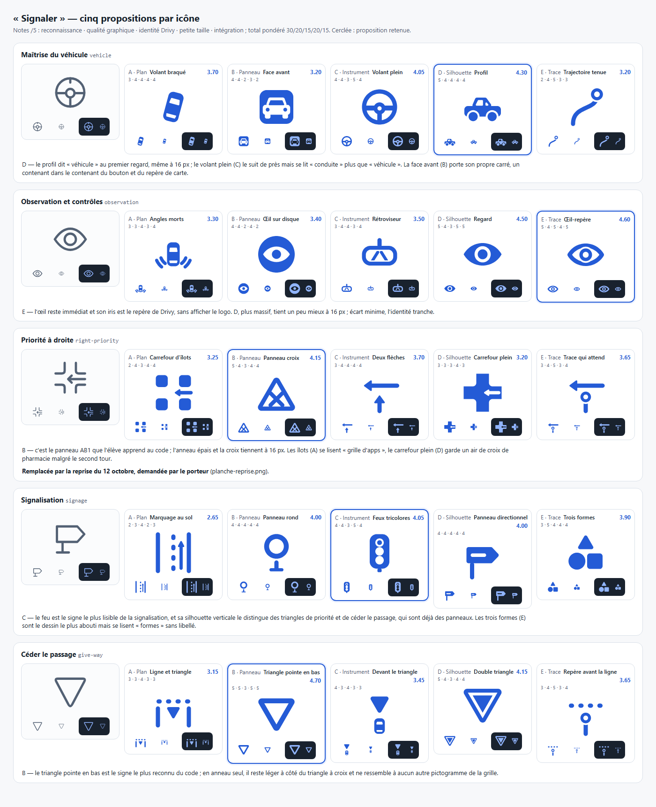
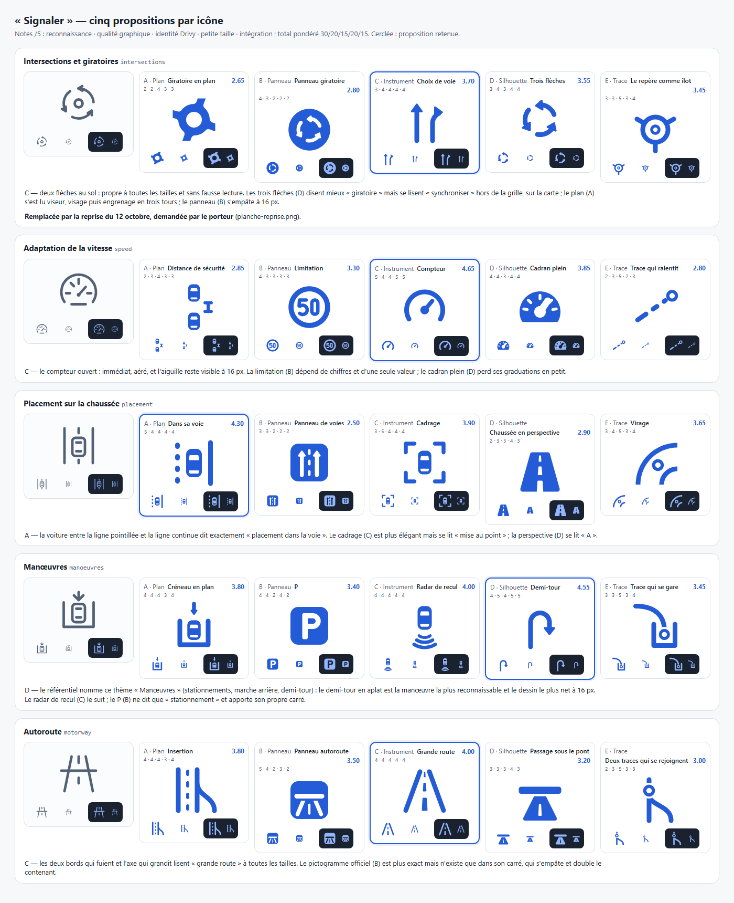
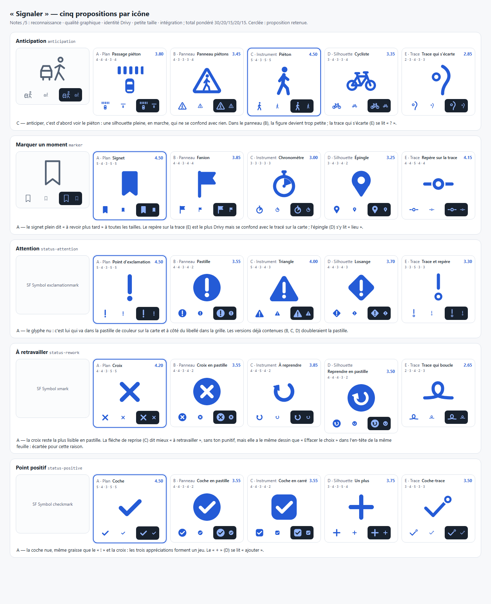
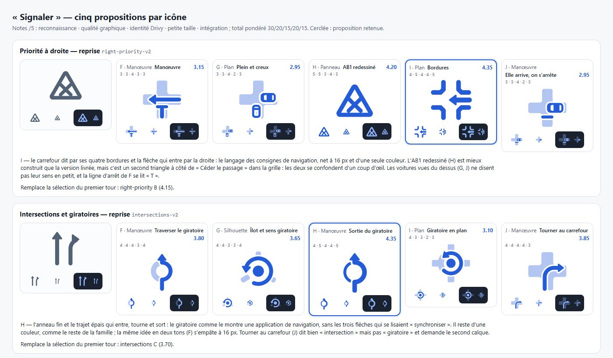

# Icônes de « Signaler » — refonte du 12 octobre 2026

À la demande du porteur, toute l’iconographie de « Signaler » est redessinée : cinq propositions par icône, une sélection automatique et argumentée, puis l’intégration partout où un signalement apparaît. Cette passe remplace la sélection du 4 octobre ([revue précédente](native-icon-signal-review-20261004.md)), dont les tracés en contour fin de 3,2 sur 64 donnaient une impression générique.

## Démarche

Elle suit les skills installés le 12 octobre :

- **logo-design** : une idée par icône, dite en une phrase ; construction par primitives à géométrie calculée ; rendu regardé à 64, 28 et 16 px à chaque tour ; un défaut nommé par proposition et par tour ; corrections optiques ; test de flou, de miroir et de lecture involontaire ; `svg_audit.py`.
- **brand-identity** : formes pleines plutôt que traits, vrais trous `evenodd` ; au plus deux tours, un troisième seulement pour lever une lecture involontaire. Sa carte `ai-defaults.md` range parmi les clichés l’« outline icon » à 2 px et bouts ronds, c’est-à-dire le style précédent.
- **La trace** ([brand-system](brand-system.md)) : bouts ronds et anneau du repère donnent la grammaire ; la grille de signalement reste native, sans logo.

## Inventaire

Quinze icônes, toutes conservées :

- **Onze thèmes**, d’après le référentiel fourni aux écoles : Maîtrise du véhicule, Observation et contrôles, Priorité à droite, Signalisation et Céder le passage (les trois sous-thèmes de « Priorités »), Intersections et giratoires, Vitesse, Placement sur la chaussée, Manœuvres (aussi « Stationnement »), Autoroute, Anticipation.
- **Le repère** « Marquer un moment ».
- **Trois appréciations** : À retravailler, Attention, Point positif, jusqu’ici des symboles SF.

Les commandes de l’en-tête (Effacer le choix, Fermer) restent des symboles système : ce sont des contrôles, pas des signalements.

## Grammaire commune

Canevas 64, formes pleines d’une seule couleur (gabarit), épaisseur 6, bouts et jonctions ronds, contre-forme d’au moins 4 pour rester ouverte à 16 px. Taille optique égalisée à l’export : √(largeur × hauteur) = 46, 56 au plus de côté, centre optique relevé d’un point ; le signet plein est réduit de 14 %.

Les cinq directions partagent cette grammaire. Choisir la meilleure de chaque icône ne casse donc pas la famille :

- **A · Plan** : la route vue du dessus, comme sur la carte ;
- **B · Panneau** : le langage des panneaux, redessiné ;
- **C · Instrument** : l’objet ou le geste du conducteur ;
- **D · Silhouette** : un objet plein, lisible de loin ;
- **E · Trace** : la trace et le repère de la marque.

## Sélection

Chaque proposition est notée sur cinq, avec une pondération : reconnaissance 30 %, qualité graphique 20 %, identité Drivy 15 %, petite taille 20 %, intégration 15 %. La plus forte note est retenue sans intervention ; un contrôle refuse un argument qui ne correspond pas aux notes. Il a joué une fois : pour Manœuvres, les notes donnaient le demi-tour devant le radar de recul que j’avais d’abord nommé, et c’est le demi-tour qui est retenu.

Les notes sont un jugement, pas une mesure. Elles ont été posées après avoir regardé les rendus.

| Icône | Retenue | Note | Suivante |
|---|---|---|---|
| Maîtrise du véhicule | D · Profil | 4.30 | C 4.05 |
| Observation et contrôles | E · Œil-repère | 4.60 | D 4.50 |
| Priorité à droite | reprise I · Bordures | 4.35 | H 4.20 (premier tour : B 4.15) |
| Signalisation | C · Feux tricolores | 4.05 | B 4.00 |
| Céder le passage | B · Triangle pointe en bas | 4.70 | D 4.15 |
| Intersections et giratoires | reprise H · Sortie du giratoire | 4.35 | J 3.85 (premier tour : C 3.70) |
| Adaptation de la vitesse | C · Compteur | 4.65 | D 3.85 |
| Placement sur la chaussée | A · Dans sa voie | 4.30 | C 3.90 |
| Manœuvres | D · Demi-tour | 4.55 | C 4.00 |
| Autoroute | C · Grande route | 4.00 | A 3.80 |
| Anticipation | C · Piéton | 4.50 | A 3.80 |
| Marquer un moment | A · Signet | 4.50 | E 4.15 |
| Attention | A · Point d'exclamation | 4.50 | C 4.00 |
| À retravailler | A · Croix | 4.20 | C 3.85 |
| Point positif | A · Coche | 4.50 | D 3.75 |

Les raisons sont détaillées sous chaque ligne de la planche.

### Reprise : priorité à droite et giratoire

Après avoir vu l'IPA, le porteur a demandé de revoir ces deux icônes. Il y a eu cinq nouvelles études chacune, dans le langage des pictogrammes de manœuvre d'Apple Plans et de Waze ; l'atelier sait désormais poser un second calque du même bleu à 35 %, comme un SF Symbol hiérarchique.

- **Priorité à droite : les bordures (I).** Le carrefour est dit par ses quatre bordures et la flèche entre par la droite. L'AB1 redessiné (H, 4,20) est mieux construit que la version livrée, mais il reste un second triangle à côté de « Céder le passage » : les deux se confondent d'un coup d'œil.
- **Giratoire : la sortie du giratoire (H).** L'anneau est fin, le trajet épais entre, tourne et sort par le haut. La première version, sortie en biais, faisait le symbole ♂ ; elle a été redressée au second tour.
- **Pourquoi tout reste d'une couleur :** les deux retenues n'ont qu'un calque, comme le reste de la famille, parce que les versions en deux tons s'empâtent à 16 px.
- **Les voitures vues du dessus (G, J) :** leur sens ne se lit pas en petit. Je me suis moi-même trompé à l'œil sur leur rotation, que j'ai dû vérifier par calcul.
- **Finition :** réduites à l'export, les deux retenues perdaient leur graisse. Bordures, flèche et trajet ont été épaissis pour retrouver l'épaisseur 6 en place.

### Tours de correction

- **Second tour**, défauts nommés : croix de pharmacie (carrefour plein), aile d’oiseau (angles morts), viseur (giratoire en plan), « A » (chaussée en perspective), « wifi » (regard porté loin), « P » (trace du giratoire), roues encombrantes (volant braqué), trop peu d’encre (trace qui ralentit).
- **Troisième tour**, seulement pour lever une lecture : le giratoire en plan est devenu un engrenage. Il est écarté, et les trois flèches aussi, qui se lisent « synchroniser » sur la carte. Le premier tour a donc livré le choix de voie, remplacé depuis par la reprise.
- **Écartée malgré le sens** : la flèche de reprise disait mieux « À retravailler », sans ton punitif, mais elle a le même dessin que « Effacer le choix » dans l’en-tête de la même feuille.

## Intégration

- **Résolveur commun** (`SchoolObservationPictogram`, `UI/DrivyObservationGlyph.swift`) : la compétence prime, car un texte relu peut tout dire ; le titre précise seulement les sous-thèmes de « Priorités ». Sans thème, le dessin est l’appréciation, puis le repère ou la note. Identifiants, textes enregistrés et règles métier ne changent pas.
- **Feuille « Signaler »** : thèmes en cobalt, appréciations dans leur couleur, repère de l’en-tête.
- **Repère de carte**, en direct, en replay et dans l’aperçu de leçon : disque annelé, thème à l’encre. L’appréciation est la couleur de l’anneau et une pastille de 16 pt qui porte son propre glyphe, pour ne jamais reposer sur la couleur seule. Le glyphe coloré a été essayé puis écarté, plus bruyant ([maquette](assets/icones-signaler-20261012/contexte.png)).
- **Replay** : détail du dock, pastilles du rail, liste des observations, menus des regroupements de la frise. Les pastilles de la frise (22 pt) gardent le glyphe d’appréciation, plus lisible à cette taille.
- **Ailleurs** : fil des observations du bilan et du résumé, ligne compacte des listes, choix d’appréciation de l’éditeur.
- **Galerie du design system** : la famille et le repère dans ses cinq états, pour la contrôler en capture.

Les SVG du catalogue mesurent 20 pt, la taille d’une icône de menu ; partout ailleurs, l’image est redimensionnée.

## Reproduire

`python atelier.py` (propositions), `python planche.py --choix`, `python contexte.py`, `python export.py` (écrit le catalogue Xcode ; une clé `-v2` notée dans `selection.json` remplace la sélection du premier tour). Dossier : [assets/icones-signaler-20261012](assets/icones-signaler-20261012). Les icônes d’avant la refonte et celles du premier tour remplacées sont archivées dans `avant/`.

## Limites

- **Avertissement d’audit** : `svg_audit.py` signale une complexité de points sur cinq fichiers. Elle vient de l’approximation polygonale des cercles, pas d’un détail en trop : les cercles ne sont pas encore des arcs.
- **Pas de recherche d’antériorité.** Les dessins sont originaux, mais les panneaux B reprennent volontairement des signes du code de la route.
- **Rien n’est vu sur appareil** : rendu à la taille réelle, VoiceOver inchangé mais non réécouté, contraste accru.
