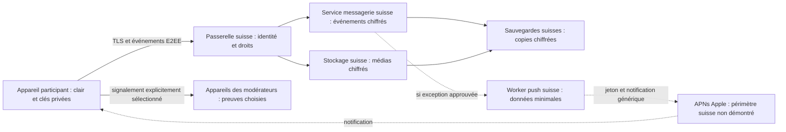

# Messagerie #65 : résidence, copies et flux suisses

23 octobre 2026. Étude #68, articulation #67 et #77. **NOT_QUALIFIED : aucune infrastructure de messagerie déployée ou auditée.** Cette note propose des exigences et une recette. Elle ne certifie ni conformité juridique, ni résidence effective, ni accord du porteur sur les exceptions. Voir `messaging-security-20261023.md`.

## 1. Frontière immédiate

Le coordinateur a autorisé le prototype isolé `prototypes/messaging-crypto/**` le 23 octobre 2026 à 01:26 UTC. Ses quatre scénarios synthétiques utilisant la machine officielle Matrix sont écrits et compilés, **non exécutés** conformément à #84. Aucun homeserver, stockage distant, push ou service tiers n'a été activé. Les téléchargements de dépendances publiques ne transportent pas de conversations. Cette compilation n'apporte aucune preuve de résidence, de restauration ou de sécurité opérationnelle.

La récupération du prototype utilise un export fichier chiffré officiel en mémoire, pas une sauvegarde serveur Matrix. La revue amont identifie un avertissement critique sur le mécanisme historique PK de sauvegarde, non appelé ici : ne pas approuver implicitement ce mécanisme pour le service suisse. Voir `../../prototypes/messaging-crypto/SECURITY-REVIEW.md` et la note sécurité.

La localisation du serveur principal ne suffit pas. L'inventaire doit couvrir calcul, bases, médias, caches, files, sauvegardes, clés serveur, identité, support, réseau, supervision et appareils. Un contenu E2EE chiffré n'est pas réputé hors du périmètre suisse par simple déclaration. Une matrice de données chiffrées et de métadonnées reste exigée par #68.

**APNs : frontière bloquante explicite.** Les documents Apple consultés décrivent l'envoi de payload et de jeton d'appareil à APNs, ainsi qu'une éventuelle conservation, mais ne fournissent pas de garantie de traitement et stockage exclusivement suisses. Conclusion de cette étude : **Suisse-only non démontré**, pas affirmation d'un pays précis non documenté. Pas d'activation APNs implicite même avec une notification générique. [A1, A2]

Si l'exigence englobe tout traitement hors Suisse, proposer une première activation éventuelle sans push distant, après approbation du reste du dossier. Si le porteur accepte un flux Apple minimal, documenter exactement l'exception, les données, la finalité et la revue requise. La seule permission de notifications iOS ne vaut pas approbation de cette exception.

## 2. Existant observé, sans connexion au homelab

Source locale : `docs/implementation/deploiement-refonte.md`, complétée par `apps/api/README.md`. Ces documents décrivent API et Keycloak sur CT114, PostgreSQL sur CT113, reverse proxy Caddy sur CT109. Le lien public est HTTPS, le lien proxy/API privé est décrit en HTTP filtré, le lien PostgreSQL utilise TLS avec vérification complète. Il s'agit d'un constat documentaire, pas de la vérification de l'état présent.

Les documents consultés ne démontrent pas à eux seuls : localisation physique du homelab, pays de l'opérateur/support et de tous les accès, destinations des sauvegardes et snapshots, éventuelles copies distantes, routage réseau, supervision ni fournisseurs annexes. Aucune de ces cases ne passe au vert grâce au nom de domaine suisse. Pas de copie des adresses privées ni des configurations sensibles dans cette note.

**Réutilisation proposée, non autorisée par cette étude :** conserver l'identité et les droits métier existants si leur périmètre est qualifié. Ajouter une isolation logique/processus et des budgets propres à la messagerie. Évaluer le homeserver candidat sans le placer dans le chemin critique des leçons. Un accord antérieur de déploiement de phase 2 ne vaut pas autorisation de la messagerie, dont #68 réclame une opération distincte.

## 3. Cartographie cible proposée



Le schéma représente une proposition, pas des routes ou des garanties en production. Les preuves de signalement transiteraient via un canal approuvé du service, jamais par un canal privé externe. Tous les accès serveur aux médias sont authentifiés et relisent les droits, même si les octets sont déjà chiffrés.

| Surface/copie | Données visibles possibles | Cible proposée et preuve nécessaire | Statut |
|---|---|---|---|
| App participant | Clair, index local, secrets, exports | Coffre local et restrictions de sauvegarde, essais Apple. Appareil mobile potentiellement hors Suisse, à expliciter au porteur. | Décision et tests requis |
| API / OIDC / passerelle | Identité, école, permissions, IP, horaires, appareils, association de routage | Implantation et accès suisses à démontrer, TLS interservices proposé, pas de contenu en logs | Inventaire incomplet |
| Homeserver / service opaque | Ciphertext, membres, identifiants, clés publiques, horaires, tailles, état de salles | Calcul et DB suisses, ports natifs non contournables, fédération et annuaires publics désactivés | Non déployé |
| Stockage média | Octets chiffrés, taille, propriétaire technique, accès | Suisse, aucun CDN externe implicite, accès authentifié et clés séparées | Non qualifié |
| Index et caches | Index local clair après déchiffrement, cache serveur opaque | Aucun index plein texte serveur du contenu sous E2EE. Tout cache personnel côté service dans le périmètre suisse | À réaliser |
| Queues/outbox/DLQ | Opaque et métadonnées de distribution | Suisse, payload exclu des erreurs et consoles, purge des doublons/copies | À réaliser |
| Sauvegardes DB, WAL, médias, snapshots | Copies ciphertext et métadonnées, éventuellement configurations | Toutes destinations et tous opérateurs identifiés, chiffrement et restauration isolée testés | Non prouvé |
| Sauvegarde des clés utilisateur | Coffre chiffré et métadonnées | Suisse côté service, secret utilisateur non récupérable par opérateur dans le modèle proposé | Décision #67 requise |
| Clés serveur et secrets d'exploitation | TLS, authentification push, clés de stockage, credentials | Coffre et secours suisses, séparation de comptes et accès minimaux | À inventorier, jamais lire/committer ici |
| Signalements | Extraits choisis et contexte, dossier d'action | Copie explicite protégée, seuls modérateurs habilités, conservation distincte approuvée | #77 bloquant |
| APNs | Jeton d'appareil, sujet applicatif, horaires, IP du fournisseur, payload | Apple, garantie Suisse-only non trouvée dans les sources consultées [A1, A2] | Bloqué sans arbitrage |
| Logs/crash/monitoring/support | Codes d'erreur, horaires et parfois métadonnées personnelles | Suisse pour données personnelles, suppression du corps avant émission, pas de session replay | À démontrer |
| CI/GitHub et dépendances | Sources publiques et fixtures synthétiques uniquement | Jamais base réelle, clés, conversations, tokens, positions ou dump appareil. Build Apple ne qualifie pas la résidence des données réelles | Règle de développement |
| DNS, certificats, réseau, identité annexe | Noms d'hôtes, adresses, données de connexion selon service | Inventorier prestataires, lieux de traitement et accès, ne pas promettre trajet réseau exclusivement suisse | Non qualifié |
| Sauvegardes OS / iCloud / partage OS | Cache, export, clés selon configuration effective | Ne pas supposer que `ThisDeviceOnly` couvre toute l'app. Tester restauration et exclusion des fichiers, informer des copies utilisateur | À qualifier |

**Matrix si retenu :** pas de fédération, bridges, bots lecteurs, serveur d'identité public, télémétrie, aperçu de lien distant ou push gateway tiers activés par défaut. L'absence de fédération doit être prouvée par configuration ET contrôle des sorties. Ne pas mettre noms, description de classe ou identité réelle dans des champs de salle dont la visibilité serveur n'a pas été examinée. C'est une exigence Drivy, pas une affirmation que la configuration amont suffit.

## 4. Contrat push proposé si une exception est approuvée

Apple préconise de ne pas inclure d'informations sensibles en clair dans un payload. Le service est best-effort, peut différer/conserver des notifications et ne constitue pas un accusé de lecture. Une réponse APNs acceptée n'est donc jamais le succès métier d'un message. [A1, A3]

Proposition minimale : notification générique sans nom, école, texte, ID de conversation, mention, résultat de sondage ou URL. Exemple de forme, **non envoyée** :

```json
{"aps":{"alert":{"title":"Drivy","body":"Nouveau message"}}}
```

- Jeton d'appareil toujours requis pour le routage APNs normal, même avec ce payload. Stocker le lien utilisateur/appareil dans le service suisse et éviter sa présence dans logs, dashboards ou traces. Apple décrit le renvoi sécurisé et le renouvellement du jeton lors de certains changements d'appareil. [A2]
- Relire droits, appareil actif et préférences avant émission. Révoquer l'abonnement après retrait, traiter jeton invalide, dédupliquer les tâches. Le contenu se récupère ensuite via service autorisé et se déchiffre dans l'app.
- Proposer `apns-expiration: 0` pour limiter les tentatives de stockage APNs, à qualifier avec la documentation Apple. Ce paramètre ne constitue pas une garantie suisse ni une preuve d'absence totale de journaux Apple. [A1]
- Éviter badges et identifiants de fil si non indispensables : ils ajoutent des informations. Un jeton opaque reste un identifiant de routage, pas une donnée anonyme par définition.
- Aucun déchiffrement dans une Notification Service Extension au premier incrément proposé. Ce serait un terminal supplémentaire à protéger et un risque d'aperçu sur écran verrouillé. Apple permet de modifier/déchiffrer dans une extension, ce n'est pas une exigence pour Drivy. [A4]
- Pas de relais push tiers, pas de service payant et aucun test réel APNs dans ce mandat. Le chargement à l'ouverture de l'app reste la voie de récupération fiable du journal, y compris push perdu.

## 5. Conservation, suppression, export et récupération

**Aucune durée numérique n'est inventée.** Faire approuver une politique versionnée par catégorie : messages, médias, votes/réactions, index locaux, caches/files, backups/WAL/snapshots, preuves d'abus, métadonnées d'accès, clés utilisateur et logs. Renseigner finalité, déclencheur, durée, responsable, exception de gel, purge et preuve. Les durées proposées pour d'autres fonctions de Drivy ne s'appliquent pas automatiquement au chat.

Exigences de réalisation proposées :

1. Suppression : tombstone durable puis suppression des copies actives et médias selon droits et politique. Répercuter recherche, épingles, compteurs et appareils à la synchronisation. La suppression serveur n'efface pas les copies déjà reçues.
2. Sauvegardes : documenter quand les objets expirent réellement et garder les tombstones/révocations nécessaires hors de l'état restauré. Les durées de ce registre doivent être cohérentes avec la plus ancienne sauvegarde restaurable.
3. Export : sous E2EE stricte, le service exporte ciphertext/métadonnées autorisées. Un export lisible est assemblé par un appareil détenteur des clés après contrôle de ses droits. Expliquer la création d'une copie locale éventuellement hors Suisse.
4. Purge : traiter média orphelin, upload incomplet, doublon de file, cache, miniature et preuve de signalement séparément. Échec = en attente/à traiter, jamais « supprimé partout » par anticipation.
5. Récupération : compte OIDC et clés utilisateur ont deux parcours distincts. Ne pas inventer de clé maîtresse opérateur pour rendre un export ou une récupération possibles.
6. Restriction chat : n'annule pas leçons, formations, dossier ni accès GPS. Le retrait de l'école suit ses propres règles, mais aucun ordre de rollback ne doit rendre le chat accessible à une ancienne appartenance.

## 6. Exploitation et reprise proposées

- Environnements isolés, bases et comptes dédiés, secrets hors Git, composants et images verrouillés par empreinte, liste des sorties autorisées. Aucun déploiement lancé ici.
- Budget de ressources, pools DB et files propres au chat. Panne ou désactivation du chat sans arrêt de l'API scolaire ni de la capture GPS.
- Sauvegarde avant toute future modification d'infrastructure autorisée. Vérifier destination suisse et chiffrement avant de qualifier la sauvegarde, pas seulement son code retour.
- Objectifs RPO/RTO : **à approuver et mesurer**, aucune valeur inventée.
- Restauration réservée : couper sorties et accès utilisateur, restaurer DB + médias + configurations requises, rejouer révocations/tombstones plus récents depuis journal indépendant, vérifier cohérence, puis seulement envisager réouverture.
- Ne jamais réactiver automatiquement anciennes clés d'appareil, membres retirés ou tokens push. Une restauration cryptographique incohérente ferme les envois et exige resynchronisation sûre, pas un reset silencieux du chiffrement.
- Retour arrière : désactiver l'émission et conserver les écritures durables compatibles. Ne pas réinstaller un binaire ignorant les nouvelles règles ou supprimer les données pour faire réussir un démarrage.
- Diagnostic : code d'erreur stable, identifiant technique de corrélation non porteur de contenu, métriques agrégées. Pas de texte libre de message, exception sérialisant un objet SDK, dump mémoire ou trame complète dans les tickets de support.

## 7. Recette d'acceptation proposée, aucune case acquise

| ID | Preuve attendue | État de cette étude |
|---|---|---|
| RES01 | Inventaire signé des lieux, personnes, sous-traitants et sorties pour chaque ligne de la cartographie | Non exécuté |
| RES02 | Test réseau synthétique : destinations autorisées seulement, aucune fédération/preview/télémétrie cachée | Non exécuté |
| RES03 | Sentinelles dans message/média/preuve, inspection logs/crash/queues/CI sans contenu ni clé | Non exécuté |
| RES04 | Sauvegarde chiffrée puis restauration isolée complète avec messages et médias synthétiques | Non exécuté |
| RES05 | Retrait/suppression après sauvegarde, restauration ancienne, contrôle de non-résurrection des droits et données | Non exécuté |
| RES06 | Purge par catégorie avec horloge contrôlée selon politique approuvée, pannes/reprises et copies orphelines | Politique absente |
| RES07 | Export authentifié : clair seulement sur appareil habilité, autre école et ADMIN non participant refusés | Non exécuté |
| RES08 | Worker push simulé : payload minimal, droits recontrôlés, zéro envoi réel | Non exécuté |
| RES09 | Backup/restore téléphone, appareil verrouillé/perdu, clé manquante, export utilisateur | Runner/appareil Apple requis |
| RES10 | Panne service chat et saturation de file sans incident leçon/GPS | Non exécuté |
| RES11 | Revue indépendante du modèle de confiance et du périmètre suisse, arbitrage APNs/appareils documenté | Non exécuté |

## 8. Décisions à obtenir et sources

Avant activation : approuver séparément lecteurs/cryptographie (#67), droits et parcours (#66/#69), conservation et copies (#68), modération minimale (#77), frontières APNs/appareils. Documenter le sort des utilisateurs voyageant hors Suisse plutôt que promettre une localisation de leurs téléphones. Aucun consentement ou validation n'est fabriqué par cette note.

Sources Apple officielles consultées le 23 octobre 2026, pages mouvantes :

- A1 : envoi APNs, token/payload, stockage éventuel et expiration. `https://developer.apple.com/documentation/usernotifications/sending-notification-requests-to-apns`.
- A2 : inscription et transmission sécurisée des tokens. `https://developer.apple.com/documentation/usernotifications/registering-your-app-with-apns`.
- A3 : payload et exclusion des données sensibles. `https://developer.apple.com/documentation/UserNotifications/generating-a-remote-notification`.
- A4 : modification/déchiffrement dans une extension. `https://developer.apple.com/documentation/usernotifications/modifying-content-in-newly-delivered-notifications`.

Sources locales : AGENTS.md, conception `04-technique/securite-vie-privee.md`, `docs/implementation/deploiement-refonte.md`, issues #68 et #77. La présente note ne déduit aucune garantie contractuelle ou juridique d'une documentation technique Apple. Une revue juridique ciblée du montage réel reste à obtenir, sans affirmer ici une règle de transfert non vérifiée.

**Livré :** inventaire documentaire partiel, cartographie cible, blocages et protocole de recette. **Non livré :** infrastructure suisse qualifiée, restauration réelle, purge effective, APNs approuvé ou messagerie activée. Le coordinateur doit conserver ces limites dans STATUS.md, hors propriété de cette contribution.
